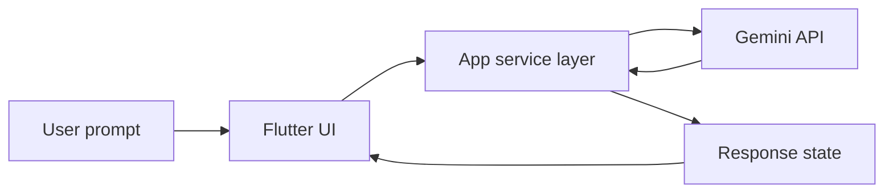

<div align="center">


<br/>


<br/>

<a href="https://share.google/UXuQt1IlUinUEl1Da"></a>
&nbsp;
<a href="https://share.google/UXuQt1IlUinUEl1Da"></a>
&nbsp;
<a href="https://share.google/UXuQt1IlUinUEl1Da"></a>

<br/><br/>


</div>

---

## ✨ Meet Flutter Gemini AI App

**Flutter Gemini AI App** is a project concept centered on bringing Google's Gemini AI capabilities into a Flutter application. It combines the expressive UI toolkit of Flutter with the possibilities of modern generative AI, making it a useful starting point for exploring conversational interfaces and AI-assisted mobile experiences.

> **One interface. A world of AI possibilities.** Explore how a Flutter front end can communicate with an AI service, display responses, and turn model output into a polished user experience.

**Project note:** This README describes the intended technology stack and a typical integration workflow. Exact features, supported platforms, dependencies, and setup commands must be verified against the actual project files.

## 🪄 What You Can Explore

| 🧭 Area | 💡 Why It Matters |
|:--|:--|
| **Conversational UI** | Design chat screens with message bubbles, input controls, and response states |
| **Gemini Integration** | Learn how an app can submit prompts and receive model-generated responses |
| **Responsive Flutter Design** | Create layouts that adapt to different screen sizes |
| **Async User Experience** | Handle loading, errors, retries, and interrupted requests |
| **Extensible Architecture** | Separate widgets, application state, and service integration |
| **Responsible AI UX** | Communicate limitations and handle model responses thoughtfully |

---

## 🧩 The Experience, Layer by Layer

<div align="center">

| 01 · PRESENT | 02 · CONNECT | 03 · RESPOND |
|:--:|:--:|:--:|
| 🎨 **Flutter Interface** | 🔌 **API Service** | ✨ **Gemini Model** |
| Collect input and render messages | Send authorized requests and handle responses | Generate output based on submitted prompts |

</div>



*Illustrative architecture — not a verified diagram of this project's implementation.*

## 🖼️ Interface Preview

<div align="center">


</div>

---

## 🚀 Getting Started

The steps below are a **general Flutter + Gemini development checklist**, not confirmed installation instructions for this particular download.

**1. Prepare your environment**

Install the Flutter SDK and an appropriate editor, then check your development environment:

```bash
flutter doctor
```

**2. Explore the project**

Use the project link to access the available files or documentation. If it contains a Flutter project, inspect `pubspec.yaml` and the source tree before running it.

**3. Install declared dependencies**

From the Flutter project's root directory:

```bash
flutter pub get
```

**4. Configure Gemini access**

Use an authorized API key and the integration approach documented by the project. Avoid committing secrets to a public repository. For deployed applications, consider a backend or another appropriate mechanism to protect credentials.

**5. Run and iterate**

Once the project's requirements are satisfied:

```bash
flutter run
```

## 🛠️ Build Better AI Experiences

| Design consideration | Recommended approach |
|:--|:--|
| **Slow responses** | Show progress and allow cancellation where supported |
| **API errors** | Display actionable messages and safe retry options |
| **Sensitive data** | Minimize collection and avoid exposing credentials |
| **Model output** | Treat responses as generated content, not guaranteed facts |
| **Maintainability** | Keep API logic separate from presentation widgets |

---

## ❓ Frequently Asked Questions

<details>
<summary><b>Does this project require an internet connection?</b></summary>

A typical Gemini API integration sends requests to an online service. Check the actual project to confirm its implementation.

</details>

<details>
<summary><b>Is Gemini API usage free?</b></summary>

Availability of free tiers, quotas, and paid usage depends on the current Gemini API offering. Review the official terms for your account and model.

</details>

<details>
<summary><b>Can I customize the interface?</b></summary>

Flutter supports extensive UI customization. The changes possible in this specific project depend on the source files provided.

</details>

<details>
<summary><b>Which platforms are supported?</b></summary>

Flutter supports multiple platforms, but this project's actual targets have not been verified. Check its platform folders and build configuration.

</details>

<details>
<summary><b>Where can I find the project?</b></summary>

Use the project link above. Review the destination and files before installing or executing downloaded software.


---

<div align="center">

### Ready to explore mobile AI?

<a href="https://share.google/UXuQt1IlUinUEl1Da"></a>

<br/><br/>

**⭐ If this project helps you learn, consider starring its repository.**


</div>
